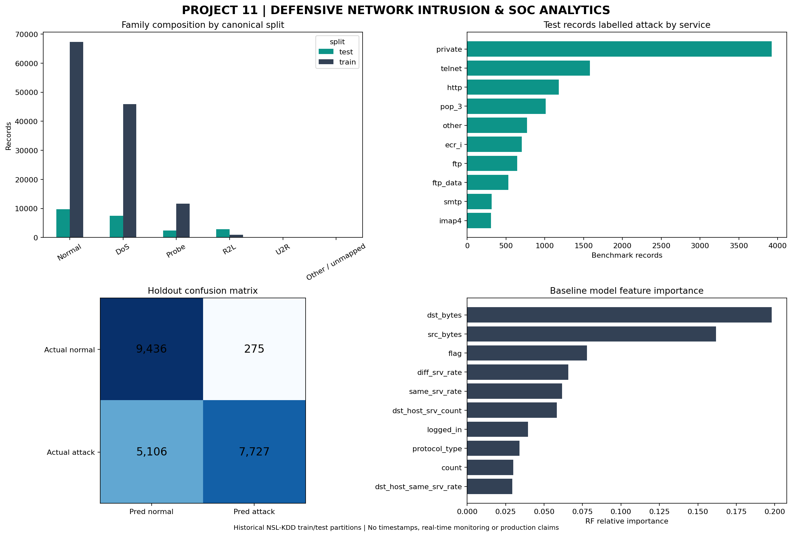

# Cybersecurity Network Intrusion & SOC Analytics — Project 11

## Executive summary
Defensive analysis of the **historical NSL-KDD academic intrusion-detection benchmark**, using Python, SQLite SQL, quality audits, a held-out ML classification baseline, and a SOC-style static dashboard. **This is NOT a live security monitoring system** and the record shares are **not real-world incident prevalence**.

## Source and provenance
- Dataset: [NSL-KDD on Kaggle](https://www.kaggle.com/datasets/hassan06/nslkdd).
- Required local downloads: `KDDTrain+.txt`, `KDDTest+.txt` (43 columns, no header). ZIP input supported.
- Academic split: training and held-out test. No event timestamp, real IP address, or real endpoint identifiers available in these files.
- Third-party input files are not redistributed in this project ZIP. Review upstream licensing/terms before publishing data separately.

## Methods
1. Discover and read full `.txt` files or Kaggle ZIP; assert exact 43-column schema.
2. Audit completeness, duplicate rows, class distributions and labels.
3. Aggregate service, protocol and attack family patterns in **SQLite**.
4. Detect attack types appearing only in the official test split.
5. Train a **RandomForestClassifier** on 41 feature columns (exclude labels, difficulty, split); fit preprocessing only on training data, assess untouched test data.
6. Reconcile SQL aggregates and confusion matrix to held-out split.
7. Generate a static PNG dashboard, evidence-based recommendations and machine-readable CSV/JSON artifacts.

## Audited data facts
| split | records | columns_original | missing_cells | duplicate_rows | normal_records | attack_records | distinct_attack_labels |
| --- | --- | --- | --- | --- | --- | --- | --- |
| train | 125973 | 43 | 0 | 0 | 67343 | 58630 | 23 |
| test | 22544 | 43 | 0 | 0 | 9711 | 12833 | 38 |

### Attack family breakdown — sample composition only
| split | attack_family | records | share_pct |
| --- | --- | --- | --- |
| test | Normal | 9711 | 43.08 |
| test | DoS | 7458 | 33.08 |
| test | R2L | 2885 | 12.8 |
| test | Probe | 2421 | 10.74 |
| test | U2R | 67 | 0.3 |
| test | Other / unmapped | 2 | 0.01 |
| train | Normal | 67343 | 53.46 |
| train | DoS | 45927 | 36.46 |
| train | Probe | 11656 | 9.25 |
| train | R2L | 995 | 0.79 |
| train | U2R | 52 | 0.04 |

### Baseline holdout evaluation
- Attack precision: **0.9656**
- Attack recall: **0.6021**
- Attack F1: **0.7417**
- False positives: **275**, false negatives: **5,106**
- Unseen attack-type labels in test: **17** (3,750 test records)
- Evaluation strictly uses canonical train/test partitions; no randomized mixing across the two splits.
- Caveat: ordinal encodings for categorical feature values are a simple baseline, not an optimized production pipeline.

## Visualization

## Seven data-grounded recommendations
| priority | recommendation | evidence | action | success_measure |
| --- | --- | --- | --- | --- |
| 1 | Treat this as benchmarking, not live alerts | Dataset has no event timestamps/IPs and is historical. | Document scope on every dashboard and avoid operational SLA language. | All public project outputs prominently state dataset limitations. |
| 2 | Prioritize attack recall alongside precision | Held-out recall=0.602; false negatives=5,106. | Review false-negative cases by family; set thresholds using validated use-case costs. | Track attack recall, miss rate, and precision together. |
| 3 | Investigate false positives before escalation | Held-out false positives=275; FPR=0.028. | Review benign records flagged by baseline and design analyst-feedback loop. | Track false positive rate and precision. |
| 4 | Evaluate unseen attack types separately | 17 attack labels are absent in train but present in test (3,750 records). | Publish model error breakdown by unseen label; avoid a single aggregate metric. | Track recall on previously unseen labels. |
| 5 | Improve schema and data quality governance | Training missing cells=0; test missing cells=0. | Validate 43-column input shape, missing values, categorical drift and duplicates. | Failed schema checks=0; audit outputs retained. |
| 6 | Use SQL segmentation for analyst-style review | Test split includes 38 distinct labels across 6 family classes. | Maintain family, service and protocol breakdowns to detect benchmark blind spots. | All grouped totals reconcile to source partition. |
| 7 | Require modern and time-aware validation before deployment | NSL-KDD is an older, non-time-stamped academic dataset. | Assess modern, licensed traffic data with legitimate collection, drift testing and security review before production use. | No production deployment claim without independent modern validation. |

## What this analysis cannot claim
- No hourly/daily anomaly trend: input has no timestamps.
- No real-time threats or current alerts: historical benchmark only.
- No affected customer IPs, devices, organizations or geography.
- No modern SOC production accuracy, impact reduction or live incident response effectiveness.
- The model predicts historical *normal vs attack*; attack-family analysis uses ground-truth dataset labels.

## Reproduce in Google Colab
1. Open `Project_11_Cybersecurity_NSLKDD_SOC_Analytics.ipynb` in Colab.
2. Upload `KDDTrain+.txt` and `KDDTest+.txt`, or the Kaggle ZIP, when Cell 1 prompts you.
3. Click **Runtime → Run all**; Cell 8 packages all generated artifacts into a ZIP.
4. Upload the saved notebook, README, requirements, dashboard PNG, aggregated outputs and project ZIP contents to GitHub. **Do not upload source records unless permitted by their license.**
5. Verify the GitHub repository against generated figures and metrics; stop when complete and consistent.

## Suggested GitHub repository
`Cybersecurity-Network-Intrusion-SOC-Analytics`

## Ethics and responsible use
This project evaluates a historical supervised benchmark for defensive training and learning. It does not provide offensive steps, real-world target selection or access to actual environments. Documentation makes synthetic/illustrative triage distinct from real operational alerts.
